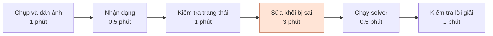
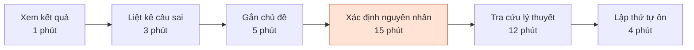
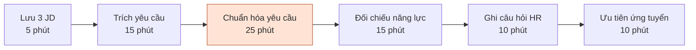

# Báo cáo cá nhân — 2A202603946_NguyenQuangTiep

> Đổi tên file theo quy tắc `MSSV_HoTen.md`, ví dụ `20241234_NguyenVanAn.md` (MSSV trước, dấu `_`, họ tên viết liền không dấu). Sửa cả dòng tiêu đề phía trên cho khớp.
> Template chi tiết và prompt mẫu cho từng mục: [docs/01-worksheet.md](../../docs/01-worksheet.md).
> Mỗi thành viên một file trong `report/individual/` trên repo nhóm: copy template này thành file mới, điền, rồi commit bằng tài khoản GitHub của bạn. Không viết hộ người khác.

## 1. Thông tin học viên

- Họ tên: Nguyễn Quang Tiệp
- MSSV: 2A202603946
- Email trường (không bắt buộc, repo có thể để public):
- Tên nhóm: NhomSH
- Link repo nhóm: https://github.com/duhocsinh4to10/K5-L3B-Day02-NHOMSH-DiscoveryProblemFraming

---

## 2. Scan problem (CP1)

| # | Lăng kính | Job Story | Ai chịu ảnh hưởng? | Dấu hiệu thật / nguồn kiểm chứng |
|---:|---|---|---|---|
| **1** | **Lặp lại** | **Khi** nhận kết quả một bài kiểm tra AI có nhiều câu sai, **tôi muốn** biết mình sai ở những nhóm kiến thức nào và nguyên nhân gì, **để** có thứ tự ôn tập phù hợp cho lần tiếp theo. | Học viên mới học AI/ML, Python. | **[Đã có sự kiện]** Một bài luyện **24 câu**, đúng **8**, sai *** (trao đổi ngày 09/10/2026). Có thể đối chiếu danh sách câu sai và đáp án gốc; **chưa đo phút phân tích/bài hoặc số lần lặp**. |
| **2** | **Lặp lại** | **Khi** dán ảnh một lượt xếp gạch vào công cụ hỗ trợ, **tôi muốn** bàn cờ và các khối được đọc đúng, **để** không mất công nhập lại và tránh nhận lời giải dựa trên dữ liệu sai. | Người chơi thử công cụ giải xếp gạch từ ảnh. | **[Đã có sự kiện]** Trò chơi có **3 khối/lượt**; đã báo tình huống nhận đúng bàn nhưng sai khối, đồng thời gửi bộ dữ liệu đặt tên **10 lượt** ngày 07/11/2026. **Chưa kiểm đếm số lượt nhận sai từ JSON và ảnh gốc**. |
| **3** | **Lặp lại** | **Khi** tham gia chương trình phát thưởng theo nhiều đợt trong ngày, **tôi muốn** đối chiếu các lần tăng số người trúng với lịch sử những ngày trước, **để** chủ động chọn thời điểm theo dõi thay vì kiểm tra liên tục. | Người tham gia chương trình khuyến mại/minigame có các đợt phát thưởng. | **[Đã có sự kiện]** Đã ghi nhận **741** người trúng ngày **22/10/2026** và các mốc **454 → 482 → 493** trong ngày **23/10/2026**. Đây là **các mốc người học cung cấp**, không phải lịch phát thưởng đã được ban tổ chức xác nhận; cần lưu nguồn gốc. |
| **4** | **Tốn thời gian** | **Khi** chương trình Python/ML chạy ra giá trị sai hoặc `NaN`, **tôi muốn** khoanh vùng đoạn code và nguyên nhân cụ thể, **để** sửa đúng và kiểm thử lại thay vì sửa thử nhiều lần. | Người học lập trình Python, đặc biệt khi làm lab ML. | **[Đã có sự kiện]** Đã trao đổi **2 tình huống kỹ thuật** ở Lab 1: kiểm tra bước cập nhật bias `b` trong Logistic Regression và xử lý trường hợp mẫu số bằng **0** ở metrics. **Chưa có thời gian/lỗi và test tái hiện**. |
| **5** | **Tốn thời gian** | **Khi** cần nộp bài qua GitHub nhưng `push` thất bại, **tôi muốn** biết lỗi thuộc nhánh, remote hay quyền truy cập, **để** gửi đúng phiên bản mà không làm hỏng lịch sử commit. | Sinh viên/học viên nộp bài bằng Git. | **[Đã có sự kiện]** Có ít nhất **3 nhóm lỗi/thông báo** đã trao đổi: `src refspec main`, upstream branch và **HTTP 403 Permission denied** khi nộp Lab 1. Cần lưu lại lệnh, thông báo đầy đủ và **đo thời gian khắc phục ở ca mới**. |
| **6** | **Tốn thời gian** | **Khi** tìm mua quạt trần phù hợp với phòng cụ thể và ngân sách giới hạn, **tôi muốn** so sánh những mẫu đáp ứng điều kiện kỹ thuật và kiểu dáng, **để** không phải mở nhiều trang sản phẩm rồi đối chiếu thủ công. | Người mua sắm thiết bị gia đình theo ràng buộc không gian/chi phí. | **[Đã có sự kiện]** Một tình huống chọn quạt cho phòng **4 × 5 m = 20 m²**, trần **3 m**, ngân sách **dưới 2 triệu đồng**. Có lịch sử trao đổi về quạt sát trần; **chưa đo số mẫu đã xem và số phút so sánh**. |
| **7** | **Cần đọc, tổng hợp nhiều thông tin** | **Khi** bắt đầu một bài lab mà hướng dẫn, rubric và mẫu báo cáo nằm ở nhiều file, **tôi muốn** tổng hợp đầy đủ các yêu cầu vào một bảng kiểm, **để** rà soát bài trước khi nộp và tránh bỏ sót mục bắt buộc. | Học viên làm lab trên repo GitHub. | **[Đã có sự kiện]** Lab 2 có ít nhất **4 nguồn cần đối chiếu**: `README.md`, `docs/01-worksheet.md`, `RUBRIC.md`, `report/individual/MSSV_HoTen.md`; bài chia thành **CP0–CP7**. **Chưa ghi nhận số mục thực tế bị sót hoặc thời gian đọc**. |
| **8** | **Cần đọc, tổng hợp nhiều thông tin** | **Khi** cân nhắc những vị trí ứng tuyển có tên gọi và yêu cầu khác nhau, **tôi muốn** đối chiếu công việc thực tế, kỹ năng bắt buộc và hướng phát triển, **để** ưu tiên công việc phù hợp thay vì dựa vào tên vị trí. | Sinh viên mới tốt nghiệp/người đang định hướng lại nghề nghiệp. | **[Đã có sự kiện]** Đã từng tìm hiểu ít nhất **4 hướng/vị trí**: PeaSoft BA/QA Intern, Catinat Design Admin, Vina Phoenix HR, Viettel Telecom Fresher. Có thể lấy lại các tin tuyển dụng/trao đổi; **chưa đo số giờ đọc JD hoặc số tiêu chí phải so sánh**. |
| **9** | **Cần đọc, tổng hợp nhiều thông tin** | **Khi** mua SIM trước khi đổi điện thoại, **tôi muốn** hiểu rõ điều kiện kích hoạt, thời hạn giữ số và khả năng tương thích máy, **để** tránh mua nhầm hoặc mất quyền sử dụng số. | Người mua SIM trực tuyến, người dự định đổi điện thoại. | **[Đã có sự kiện]** Có **1** tình huống điện thoại đang dùng chỉ có **1 khe SIM vật lý**, muốn mua SIM chưa kích hoạt trước khi đổi điện thoại; đã đặt câu hỏi về kích hoạt/giữ số. **Chưa có trường hợp mất số thực tế**, cần kiểm nguồn từ nhà mạng. |
| **10** | **Pain từ người khác (quan sát qua trải nghiệm người dùng; cần xác nhận thêm)** | **Khi** đã gửi một biểu mẫu đăng ký nhưng mở lại đường dẫn và thấy biểu mẫu mới, **tôi muốn** biết lần gửi trước đã được ghi nhận hay chưa, **để** không gửi trùng hoặc bỏ lỡ đăng ký. | Người nộp biểu mẫu tuyển sinh/ứng tuyển/sự kiện. | **[Đã có sự kiện của bản thân]** Đã có **1** trường hợp hỏi về link Microsoft Forms sau khi điền xong nhưng mở lại hiển thị biểu mẫu mới. **Không có bằng chứng lần gửi thất bại hoặc người khác cũng gặp**; cần ảnh xác nhận/biên nhận hoặc hỏi 1–2 người dùng khác. |
| **11** | **Pain từ người khác (giả thuyết cần kiểm chứng)** | **Khi** nhiều thành viên cùng sửa tài liệu trong một repo nhóm, **tôi muốn** biết ai đang chỉnh file nào và cập nhật mới nhất nằm ở đâu, **để** tránh ghi đè thay đổi và đỡ mất thời gian hòa giải xung đột. | Thành viên nhóm thực hiện bài lab dùng GitHub chung. | **[Chưa kiểm chứng pain]** Lab 2 sử dụng **1 repo nhóm** và nhiều người cùng nộp; **chưa có log conflict, lần ghi đè hoặc lời phàn nàn của bạn cùng nhóm**. Chỉ giữ làm candidate để hỏi nhóm/quan sát, **không coi là vấn đề đã được xác nhận**. |

---

## 3. Top 3 Problem Cards + quy trình nháp (CP2)

### Bảng chọn top 3

| Rank | Vấn đề | Vì sao chọn | Điều còn chưa chắc |
|---:|---|---|---|
| 1 | **Nhận diện sai khối xếp gạch từ ảnh (CP1 #2)** | Đã từng xảy ra tình huống đọc đúng bàn nhưng sai khối; có thể kiểm tra đầu ra theo từng ô. | Tỷ lệ lỗi thực tế và thời gian sửa; lỗi do cắt ảnh hay nhận dạng hình khối? |
| 2 | **Khó xác định nguyên nhân sai sau bài luyện AI (CP1 #1)** | Có một bài luyện 24 câu, sai 16 câu; quy trình ôn tập có nhiều bước, có thể đánh giá chất lượng chẩn đoán. | Bước giải thích nguyên nhân hay tìm tài liệu tốn thời gian hơn? |
| 3 | **Khó chuẩn hóa và so sánh yêu cầu tuyển dụng (CP1 #8)** | Có trải nghiệm tìm hiểu nhiều hướng công việc; đầu vào là các JD đa dạng, dễ phát sinh hiểu nhầm. | Khó khăn chính nằm ở chuẩn hóa JD hay quyết định định hướng nghề nghiệp? |

### Problem Card #1

| Trường | Nội dung |
|---|---|
| **Job Story** | **Khi** dán ảnh ván xếp gạch vào công cụ hỗ trợ, **tôi muốn** bàn và 3 khối được đọc đúng, **để** không phải sửa lại và không nhận lời giải trên trạng thái sai. |
| **Actor** | Người chơi sử dụng công cụ giải xếp gạch qua ảnh chụp màn hình. |
| **Bối cảnh** | Sau khi tải/dán ảnh, trước lúc solver tìm nước đi. Từng gặp trường hợp bàn được nhận đúng nhưng khối nhận sai. |
| **Quy trình hiện tại** | Chụp/dán ảnh → hệ thống nhận dạng → kiểm tra bàn và 3 khối → sửa ô/khối sai → chạy solver → kiểm tra lời giải. |
| **Bottleneck** | **Bước sửa trạng thái khối** khi đầu vào nhận dạng sai; dự kiến **3 phút/lượt có lỗi** (ước tính, cần đo). |
| **Impact** | Tăng thao tác, chậm có lời giải; nếu bỏ sót lỗi, solver có thể giải trên trạng thái không đúng với trò chơi. |
| **Success metric** | **Ước tính tham chiếu:** 7 phút/lượt có lỗi, **chưa đo**. **Mục tiêu:** dưới 5 phút/lượt có lỗi; ≥90% ảnh đọc đúng toàn bộ bàn và 3 khối trên bộ ảnh kiểm thử độc lập. Đo bằng đồng hồ và đối chiếu ảnh gốc. |
| **Không dùng AI** | Giao diện chỉnh tay ô bàn và 3 khối, hiển thị ảnh gốc cạnh kết quả nhận dạng. |
| **Giả thuyết AI** | Chỉ thử AI thị giác ở bước đọc ảnh nếu xử lý bằng ngưỡng màu/hình học không đạt chất lượng; người chơi vẫn được kiểm tra/sửa. |
| **Cảm nhận nhanh** | **Rule → Workflow**, chưa cần Agent. |

**Quy trình nháp — một lượt *có nhận dạng sai* (ước tính tổng 7 phút):**

**Cách xác minh:** Lưu ảnh gốc và kết quả nhận dạng từng lượt; tính `lượt đúng hoàn toàn / tổng lượt kiểm`, số khối sai và thời gian sửa. **Không tính lỗi nước đi của solver vào lỗi nhận dạng.**

---

### Problem Card #2

| Trường | Nội dung |
|---|---|
| **Job Story** | **Khi** xem lại bài luyện AI có nhiều câu sai, **tôi muốn** biết mình sai ở đâu và vì sao, **để** ôn đúng phần kiến thức còn thiếu. |
| **Actor** | Học viên mới học AI/ML và Python. |
| **Bối cảnh** | Sau một bài tự luyện 24 câu, đúng 8 và sai 16; đây không phải kết quả thi chính thức. |
| **Quy trình hiện tại** | Xem đáp án → liệt kê câu sai → phân loại chủ đề → xác định nguyên nhân → tìm tài liệu → ưu tiên ôn tập. |
| **Bottleneck** | **Xác định nguyên nhân sai** (thiếu kiến thức, nhầm phép tính/cú pháp, đọc nhầm câu hỏi...), dự kiến **15 phút/bài** (ước tính, cần đo). |
| **Impact** | Có thể ôn sai trọng tâm hoặc học lại quá nhiều nội dung; số câu sai không tự cho biết nguyên nhân. |
| **Success metric** | **Dữ kiện có thật:** 16/24 câu sai trong một bài luyện. **Ước tính tham chiếu:** 40 phút để phân tích một bài và lập kế hoạch, **chưa đo**. **Mục tiêu:** tối đa 28 phút cho bài tương đương; mỗi kết luận về nguyên nhân sai có giải thích/đối chiếu, không chỉ gắn nhãn theo đáp án. |
| **Không dùng AI** | Nhật ký lỗi sai theo chủ đề; làm lại câu cùng dạng và đối chiếu giáo trình/đáp án. |
| **Giả thuyết AI** | AI gợi ý giải thích và đặt câu hỏi chẩn đoán thêm dựa trên cách học viên lập luận; người học đối chiếu với nguồn chuẩn. |
| **Cảm nhận nhanh** | **Rule** cho đếm lỗi theo chủ đề; **Workflow** cho giải thích nguyên nhân nếu cần. |

**Quy trình nháp — một bài 24 câu (ước tính tổng 40 phút):**

**Cách xác minh:** Bấm giờ từng bước trên bài luyện; lưu mã câu, câu đã chọn, đáp án đúng và lời giải thích cá nhân. Tách **chủ đề câu sai** khỏi **nguyên nhân thực sự khiến mình sai**.

---

### Problem Card #3

| Trường | Nội dung |
|---|---|
| **Job Story** | **Khi** đọc nhiều JD có cách mô tả khác nhau, **tôi muốn** so sánh yêu cầu bắt buộc, yêu cầu ưu tiên và kỹ năng của mình, **để** lựa chọn thứ tự ứng tuyển phù hợp. |
| **Actor** | Sinh viên CNTT mới tốt nghiệp hoặc người chuyển định hướng nghề nghiệp. |
| **Bối cảnh** | Trước khi ứng tuyển các vị trí như BA/QA Intern, Admin, HR, Fresher. Các vị trí từng tìm hiểu **không đồng nghĩa đã có 3 JD gốc để đối chiếu**. |
| **Quy trình hiện tại** | Lưu JD → trích yêu cầu → chuẩn hóa cách diễn đạt → đối chiếu năng lực → ghi điều cần hỏi HR → ưu tiên ứng tuyển. |
| **Bottleneck** | **Chuẩn hóa yêu cầu giữa các JD** để không nhầm kỹ năng bắt buộc với ưu tiên; dự kiến **25 phút/bộ 3 JD** (ước tính, cần đo). |
| **Impact** | Dễ bỏ sót điều kiện bắt buộc, lặp công đọc tài liệu hoặc so sánh các vị trí trên tiêu chí không thống nhất. |
| **Success metric** | **Ước tính tham chiếu:** 80 phút so sánh 3 JD, **chưa đo**. **Mục tiêu:** tối đa 56 phút/3 JD; không bỏ sót yêu cầu bắt buộc khi đối chiếu từng JD gốc. |
| **Không dùng AI** | Dùng bảng so sánh cố định, cột tách rõ bắt buộc/ưu tiên; lọc điều kiện cứng trước khi chấm mức phù hợp. |
| **Giả thuyết AI** | AI trích xuất và chuẩn hóa yêu cầu từ JD, nhưng phải chỉ rõ đoạn nguồn để người ứng tuyển kiểm tra lại. |
| **Cảm nhận nhanh** | **No AI/Rule trước**, cân nhắc Workflow khi phải xử lý nhiều JD tự do. |

**Quy trình nháp — đối chiếu 3 JD (ước tính tổng 80 phút):**

**Cách xác minh:** Chọn 3 JD thực tế, lưu link/ảnh gốc, bấm giờ 6 bước và đối chiếu lại các yêu cầu bắt buộc. Không dùng thông tin do AI suy đoán thay cho JD.

---

### Card muốn pitch nhất

**Card #1 — Nhận diện sai khối xếp gạch từ ảnh.** Đây là vấn đề có biểu hiện cụ thể, có thể kiểm bằng ảnh gốc và kết quả đọc từng ô; có thể thử phương án Rule trước khi dùng AI thị giác. **Điều muốn nhóm phản biện:** Nếu người dùng sửa tay nhanh, có nhất thiết đầu tư nhận dạng AI không?

### AI đã phản biện card thế nào

| Phản biện AI | Điều chỉnh trong bản nháp |
|---|---|
| **Card #1:** Trộn lỗi nhận dạng và lỗi thuật toán tìm nước đi. | Chỉ giữ lỗi **đọc trạng thái từ ảnh**; tách lỗi solver thành vấn đề khác. |
| **Card #2:** Dùng 16/24 câu sai làm đại diện cho thời gian xử lý hoặc số lỗ hổng kiến thức. | Đưa 16 câu sai vào bối cảnh; thời gian chỉ là **ước tính chưa kiểm chứng**, nguyên nhân cần xem lời giải thích của người học. |
| **Card #3:** Phạm vi trải từ chọn nghề tới dự đoán kết quả tuyển dụng. | Thu hẹp vào **chuẩn hóa và so sánh yêu cầu JD**. |
| **Cả ba:** Thời gian ban đầu chưa có, không thể gọi target là kết quả. | Bổ sung thời gian **ước tính**, tổng theo từng bước và cách kiểm chứng; chỉ chuyển sang baseline sau khi đo thật. |

---

## 4. Tôi đã tham gia phần nào (CP3 → CP7)

| Hoạt động | Tôi đã làm gì? | Kết quả / ảnh hưởng tới bài nhóm |
|---|---|---|
| **Pitch Problem Card (CP3)** | Chuẩn bị 3 candidate cá nhân và đưa vào bảng pitch của nhóm: **#10** nhận diện bàn/khối xếp gạch từ ảnh; **#11** xác định nguyên nhân sai sau bài luyện AI; **#12** chuẩn hóa yêu cầu tuyển dụng để so sánh JD. | Bảng pitch của nhóm có đủ **12 candidate**, trong đó có 3 candidate đứng tên Nguyễn Quang Tiệp. Chưa đồng nghĩa với việc nhóm đã chọn candidate của tôi. |
| **Phản biện bài của bạn khác (CP3)** | Đặt câu hỏi cho **#3 (Nguyễn Lương Phúc)**: “Nếu nhóm ghim (pin) ngay tin nhắn chốt quyết định lên đầu group thì có giải quyết được không?”; cho **#5 (Nguyễn Tiến Đạt)**: “Nỗi đau này do thiếu công cụ AI hay đơn giản là do ý thức và kỷ luật gửi bài của thành viên?”; cho **#9 (Trần Xuân Lộc)**: “Làm sao AI phân biệt được chính xác bình luận của người dùng thật với nick seeding được thuê viết mượt?” | Các câu hỏi đã được ghi tại mục **2.1 Pitch** trong `report/team/group_report.md`. Chúng đặt vấn đề về giải pháp không dùng AI, nguyên nhân thật của pain và giới hạn khả thi của AI; **báo cáo nhóm chưa ghi câu trả lời hoặc thay đổi sau phản biện**. |
| **Nhận phản biện (CP3)** | **#10:** Trần Xuân Lộc hỏi lỗi do chất lượng ảnh hay mô hình AI. **#11:** Nguyễn Lương Phúc hỏi cách phân biệt hổng kiến thức với đọc nhầm đề. **#12:** Nguyễn Tiến Đạt hỏi cách đo độ phù hợp với các yếu tố mềm như môi trường/lộ trình thăng tiến. | Ba câu hỏi đã có trong báo cáo nhóm. **Hướng kiểm chứng dự kiến:** (1) phân loại nguyên nhân ảnh lỗi; (2) thu thập lập luận của học viên thay vì chỉ nhìn đáp án; (3) tách yêu cầu trong JD có thể kiểm chứng khỏi đánh giá chủ quan. Chưa ghi nhận đây là các bước đã được nhóm thực hiện. |
| **Gom cluster / cây OST (CP3)** | | Nhóm gom 12 candidate thành 4 cụm. |
| **Chọn candidate problem (CP3)** | | Nhóm chọn #7 với 34/35 điểm. |
| **Kiểm chứng / research (CP4)** | | Một thành viên tự bấm giờ gần 20 phút cho một buổi. Cả 4/4 thành viên cho biết từng quên việc hoặc nhầm hạn. Đây là dữ liệu nội bộ (mục 3.2). |
| **Quy trình nhóm (CP5)** | | |
| **Problem Statement (CP5–CP6)** | Cập nhật mục 7 trong commit `fbea3bc`. | Bản tôi cập nhật có ba tiêu chí: đủ việc, đúng phân công, dễ đối chiếu. Bản chung ở mục 7 hoàn thiện thành năm tiêu chí: đủ việc đã chốt, không bịa, đúng người và hạn, dễ đối chiếu, dễ duyệt. |
| **Mức can thiệp AI (CP6)** | Cập nhật mục 6 trong cùng commit. | So sánh bốn mức can thiệp và xác định người duyệt bản nháp. |
| **Quyết định (CP6)** | | Nhóm chọn Not Yet vì còn thiếu kiểm chứng ngoài nhóm và phép đo thực tế. |

---

## 5. Dùng AI

| Checkpoint | Tôi dùng AI để làm gì? | AI hữu ích ở đâu? | AI sai hoặc hời hợt ở đâu? | Tôi sửa gì bằng nhận định của mình? |
|---|---|---|---|---|
| **CP1 Scan** | Trao đổi với ChatGPT để mở rộng danh sách vấn đề từ trải nghiệm học AI, lập trình, trò chơi, mua sắm, việc làm và công cụ trực tuyến; tổ chức thành các Job Story theo bốn lăng kính. | Có thêm góc nhìn đa lĩnh vực, actor và cách nhận diện nguồn bằng chứng; lập được **11 candidate** để xem xét. | Một số ý chỉ phản ánh trải nghiệm cá nhân, chưa phải “pain từ người khác”; AI không thể tự biết thời gian và tần suất thật. | Giữ tình huống có dấu vết đã xảy ra; đánh dấu **“chưa đo/chưa kiểm chứng”** cho thời gian, số lượt và phản hồi người khác; không dùng phỏng đoán làm bằng chứng. |
| **CP2 Problem Card** | Dùng ChatGPT hỗ trợ chọn Top 3, rút gọn phạm vi, dựng quy trình Mermaid và phản biện bottleneck/metric của từng card. | Phát hiện card xếp gạch cần tách lỗi đọc ảnh khỏi lỗi solver; card học AI cần phân biệt chủ đề câu sai với nguyên nhân; card tuyển dụng phải tập trung vào yêu cầu JD. | AI đã đưa thời gian **3 / 15 / 25 phút cho bottleneck** và tổng **7 / 40 / 80 phút** dựa trên ước tính, không phải phép đo; có nguy cơ đề xuất AI quá sớm. | Ghi rõ số phút **ước tính**, chưa gọi là baseline thực đo; bổ sung cách đo lại; ưu tiên thử **No AI/Rule** trước khi kết luận cần Workflow/AI. |
| **CP4 Research** | | | | |
| **CP5 Quy trình** | | | | |
| **CP5–6 Problem Statement** | Nhờ ChatGPT soạn nháp mục 7 và đối chiếu lại với v0. | Phân biệt thời gian soạn/soát và tổng thời gian sau họp. | Bản đầu dùng ước tính từ pitch và để trống target. | Tôi yêu cầu đọc lại báo cáo mới để cập nhật mục tiêu dưới 7 phút cho riêng khâu soạn và rà soát. |
| **CP6 Mức can thiệp / quyết định** | Nhờ ChatGPT hỗ trợ bảng so sánh và rà AI Canvas. | Làm rõ bước AI soạn, người duyệt và Rule gửi. | Bản đầu ghi người phụ trách trực tiếp gửi danh sách. | Tôi yêu cầu bám đúng template và để trống chỗ thiếu dữ liệu. Lựa chọn Workflow của nhóm chưa đủ để kết luận người dùng muốn tự động gửi. |

---

## 6. Reflection (CP7)

Trả lời bằng trải nghiệm thật của bạn, tối thiểu 200 từ cho các câu 6.1–6.6 (không tính 6.7, câu này được chấm riêng ở tiêu chí C5). **Không dùng AI để viết thay.**

**6.1. Tôi học được gì khi nghe top 3 problems của các bạn khác?**

Khi một bạn trình bày việc phải tìm lại quyết định cũ trong nhóm chat, tôi hỏi liệu ghim tin nhắn chốt có giải quyết được không. Qua ví dụ đó, tôi thấy cần hiểu vì sao thông tin bị thất lạc trước khi đề xuất công cụ tìm kiếm.

**6.2. Nhóm có lúc nào bị "solution-first" (nghĩ giải pháp trước khi hiểu vấn đề) không? Lúc đó nhóm nhận ra và xử lý thế nào?**

Nhóm từng đưa ý tưởng AI ghi âm và bot tự giao việc vào cây OST. Khi gạch hai ý này, nhóm xác định rõ hơn điều cần giải quyết: người ghi chép mất thời gian đọc lại chữ viết tắt, nhớ phần phân công và soạn danh sách sau họp.

**6.3. Tôi có đổi ý sau khi bị phản biện không? Kể một lần cụ thể.**

Ở card về bài luyện AI, tôi thu hẹp kết luận sau câu hỏi làm sao phân biệt hổng kiến thức với đọc nhầm đề. Đáp án sai cho biết chủ đề cần xem lại. Muốn biết nguyên nhân, cần xem lập luận của học viên hoặc cách họ làm lại một câu tương tự.

**6.4. Kết quả kiểm chứng (phỏng vấn/survey/research) có làm tôi bất ngờ không? Điều gì?**

Báo cáo chưa có kết quả phỏng vấn ngoài nhóm để tôi nhận xét điều gì gây bất ngờ. Khi xem lại số phút ghi trong pitch, tôi thấy vẫn cần bấm giờ các buổi họp thật để biết khâu nào tốn công và mức độ lặp lại.

**6.5. Điều khó nhất khi viết Problem Statement là gì?**

Điểm dễ nhầm nhất là chọn mốc bắt đầu và kết thúc phép đo. Từ lúc mở ghi chú đến khi gửi tin nhắn có cả định dạng và gửi. Nếu dùng toàn bộ khoảng đó để đánh giá mục tiêu dưới 7 phút cho riêng khâu soạn và rà soát, kết quả sẽ khó diễn giải.

**6.6. Nếu làm lại, tôi sẽ đổi gì? Tôi sẽ phản biện nhóm mạnh hơn ở điểm nào?**

Nếu làm lại, tôi sẽ hỏi sớm hơn ai xác nhận danh sách việc chuẩn và xử lý thế nào khi ghi chú thiếu người phụ trách. Tôi sẽ đề nghị thử mẫu ghi việc thủ công và Workflow trên cùng một ghi chú, rồi so cả thời gian sửa lẫn số việc sai hoặc sót.

**6.7. Hiểu bài:** giải thích bằng 5–8 câu, không nhìn tài liệu, chuỗi *problem → quy trình → metric → boundary → mức can thiệp AI → quyết định* của bài nhóm mình.

Trưởng nhóm hoặc thư ký mất thời gian chuyển ghi chú sau họp thành danh sách phân công. Hai bước tốn công là viết lại ghi chú và rà xem có sót việc hay nhầm người. Nhóm đặt mục tiêu thời gian soạn và rà soát trung vị dưới 7 phút, đồng thời ghi đủ việc đã chốt. AI chỉ soạn nháp và gắn cờ thông tin còn thiếu để người ghi chép xác minh trước khi gửi. Nhóm chọn Workflow vì các bước đã biết trước và phần cần AI là diễn giải ghi chú. Quyết định hiện tại là Not Yet vì còn thiếu kiểm chứng ngoài nhóm và số liệu đo từ các buổi họp thật.

---

## 7. Tài liệu tham khảo

1. Nhóm NhomSH, [README.md — Day 02 Discovery & Problem Framing](../../README.md), cấu trúc và mục tiêu Lab 2.
2. Nhóm NhomSH, [RULES.md](../../RULES.md), quy tắc sử dụng AI, phản biện CP3, reflection CP7 và liêm chính học thuật.
3. Nhóm NhomSH, [CHECKPOINTS.md](../../CHECKPOINTS.md), yêu cầu từng checkpoint.
4. Nhóm NhomSH, [RUBRIC.md](../../RUBRIC.md), tiêu chí chấm điểm.
5. Nhóm NhomSH, [docs/01-worksheet.md](../../docs/01-worksheet.md), hướng dẫn Job Story, Problem Card và các phương pháp kiểm chứng.
6. Nhóm NhomSH, [docs/02-deliverable-example.md](../../docs/02-deliverable-example.md), bài mẫu tham khảo cách trình bày, không sao chép nội dung.
7. Nhóm NhomSH, [report/team/group_report.md — mục 2.1](../team/group_report.md), ghi nhận các candidate #1–12 và câu hỏi phản biện ở CP3 (đối chiếu ngày 09/11/2026).
