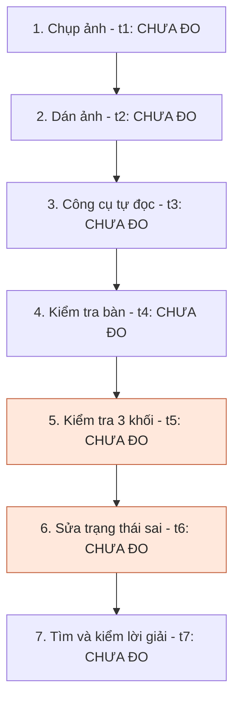
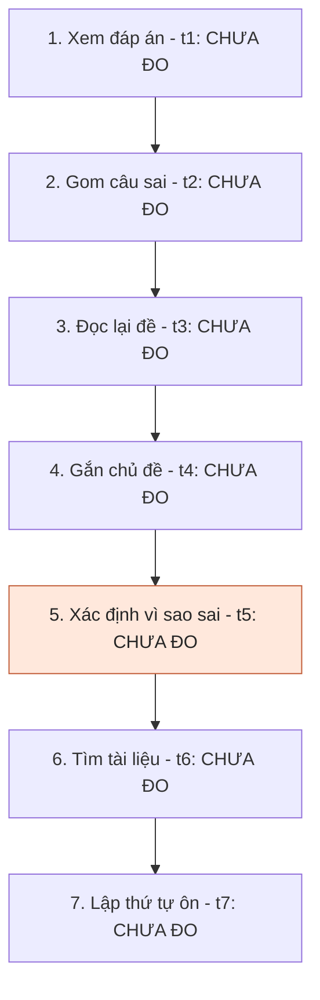
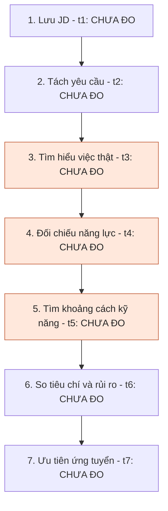

# Báo cáo cá nhân — 2A202603946_NguyenQuangTiep

> Đổi tên file theo quy tắc `MSSV_HoTen.md`, ví dụ `20241234_NguyenVanAn.md` (MSSV trước, dấu `_`, họ tên viết liền không dấu). Sửa cả dòng tiêu đề phía trên cho khớp.
> Template chi tiết và prompt mẫu cho từng mục: [docs/01-worksheet.md](../../docs/01-worksheet.md).
> Mỗi thành viên một file trong `report/individual/` trên repo nhóm: copy template này thành file mới, điền, rồi commit bằng tài khoản GitHub của bạn. Không viết hộ người khác.

## 1. Thông tin học viên

- Họ tên: Nguyễn Quang Tiệp
- MSSV: 2A202603946
- Email trường (không bắt buộc, repo có thể để public):
- Tên nhóm: NhomSH
- Link repo nhóm: https://github.com/duhocsinh4to10/K5-L3B-Day02-NHOMSH-DiscoveryProblemFraming

---

## 2. Scan problem (CP1)

| # | Lăng kính | Job Story | Ai chịu ảnh hưởng? | Dấu hiệu thật / nguồn kiểm chứng |
|---:|---|---|---|---|
| **1** | **Lặp lại** | **Khi** nhận kết quả một bài kiểm tra AI có nhiều câu sai, **tôi muốn** biết mình sai ở những nhóm kiến thức nào và nguyên nhân gì, **để** có thứ tự ôn tập phù hợp cho lần tiếp theo. | Học viên mới học AI/ML, Python. | **[Đã có sự kiện]** Một bài luyện **24 câu**, đúng **8**, sai **16** (trao đổi ngày 09/10/2026). Có thể đối chiếu danh sách câu sai và đáp án gốc; **chưa đo phút phân tích/bài hoặc số lần lặp**. |
| **2** | **Lặp lại** | **Khi** dán ảnh một lượt xếp gạch vào công cụ hỗ trợ, **tôi muốn** bàn cờ và các khối được đọc đúng, **để** không mất công nhập lại và tránh nhận lời giải dựa trên dữ liệu sai. | Người chơi thử công cụ giải xếp gạch từ ảnh. | **[Đã có sự kiện]** Trò chơi có **3 khối/lượt**; đã báo tình huống nhận đúng bàn nhưng sai khối, đồng thời gửi bộ dữ liệu đặt tên **10 lượt** ngày 07/11/2026. **Chưa kiểm đếm số lượt nhận sai từ JSON và ảnh gốc**. |
| **3** | **Lặp lại** | **Khi** tham gia chương trình phát thưởng theo nhiều đợt trong ngày, **tôi muốn** đối chiếu các lần tăng số người trúng với lịch sử những ngày trước, **để** chủ động chọn thời điểm theo dõi thay vì kiểm tra liên tục. | Người tham gia chương trình khuyến mại/minigame có các đợt phát thưởng. | **[Đã có sự kiện]** Đã ghi nhận **741** người trúng ngày **22/10/2026** và các mốc **454 → 482 → 493** trong ngày **23/10/2026**. Đây là **các mốc người học cung cấp**, không phải lịch phát thưởng đã được ban tổ chức xác nhận; cần lưu nguồn gốc. |
| **4** | **Tốn thời gian** | **Khi** chương trình Python/ML chạy ra giá trị sai hoặc `NaN`, **tôi muốn** khoanh vùng đoạn code và nguyên nhân cụ thể, **để** sửa đúng và kiểm thử lại thay vì sửa thử nhiều lần. | Người học lập trình Python, đặc biệt khi làm lab ML. | **[Đã có sự kiện]** Đã trao đổi **2 tình huống kỹ thuật** ở Lab 1: kiểm tra bước cập nhật bias `b` trong Logistic Regression và xử lý trường hợp mẫu số bằng **0** ở metrics. **Chưa có thời gian/lỗi và test tái hiện**. |
| **5** | **Tốn thời gian** | **Khi** cần nộp bài qua GitHub nhưng `push` thất bại, **tôi muốn** biết lỗi thuộc nhánh, remote hay quyền truy cập, **để** gửi đúng phiên bản mà không làm hỏng lịch sử commit. | Sinh viên/học viên nộp bài bằng Git. | **[Đã có sự kiện]** Có ít nhất **3 nhóm lỗi/thông báo** đã trao đổi: `src refspec main`, upstream branch và **HTTP 403 Permission denied** khi nộp Lab 1. Cần lưu lại lệnh, thông báo đầy đủ và **đo thời gian khắc phục ở ca mới**. |
| **6** | **Tốn thời gian** | **Khi** tìm mua quạt trần phù hợp với phòng cụ thể và ngân sách giới hạn, **tôi muốn** so sánh những mẫu đáp ứng điều kiện kỹ thuật và kiểu dáng, **để** không phải mở nhiều trang sản phẩm rồi đối chiếu thủ công. | Người mua sắm thiết bị gia đình theo ràng buộc không gian/chi phí. | **[Đã có sự kiện]** Một tình huống chọn quạt cho phòng **4 × 5 m = 20 m²**, trần **3 m**, ngân sách **dưới 2 triệu đồng**. Có lịch sử trao đổi về quạt sát trần; **chưa đo số mẫu đã xem và số phút so sánh**. |
| **7** | **Cần đọc, tổng hợp nhiều thông tin** | **Khi** bắt đầu một bài lab mà hướng dẫn, rubric và mẫu báo cáo nằm ở nhiều file, **tôi muốn** tổng hợp đầy đủ các yêu cầu vào một bảng kiểm, **để** rà soát bài trước khi nộp và tránh bỏ sót mục bắt buộc. | Học viên làm lab trên repo GitHub. | **[Đã có sự kiện]** Lab 2 có ít nhất **4 nguồn cần đối chiếu**: `README.md`, `docs/01-worksheet.md`, `RUBRIC.md`, `report/individual/MSSV_HoTen.md`; bài chia thành **CP0–CP7**. **Chưa ghi nhận số mục thực tế bị sót hoặc thời gian đọc**. |
| **8** | **Cần đọc, tổng hợp nhiều thông tin** | **Khi** cân nhắc những vị trí ứng tuyển có tên gọi và yêu cầu khác nhau, **tôi muốn** đối chiếu công việc thực tế, kỹ năng bắt buộc và hướng phát triển, **để** ưu tiên công việc phù hợp thay vì dựa vào tên vị trí. | Sinh viên mới tốt nghiệp/người đang định hướng lại nghề nghiệp. | **[Đã có sự kiện]** Đã từng tìm hiểu ít nhất **4 hướng/vị trí**: PeaSoft BA/QA Intern, Catinat Design Admin, Vina Phoenix HR, Viettel Telecom Fresher. Có thể lấy lại các tin tuyển dụng/trao đổi; **chưa đo số giờ đọc JD hoặc số tiêu chí phải so sánh**. |
| **9** | **Cần đọc, tổng hợp nhiều thông tin** | **Khi** mua SIM trước khi đổi điện thoại, **tôi muốn** hiểu rõ điều kiện kích hoạt, thời hạn giữ số và khả năng tương thích máy, **để** tránh mua nhầm hoặc mất quyền sử dụng số. | Người mua SIM trực tuyến, người dự định đổi điện thoại. | **[Đã có sự kiện]** Có **1** tình huống điện thoại đang dùng chỉ có **1 khe SIM vật lý**, muốn mua SIM chưa kích hoạt trước khi đổi điện thoại; đã đặt câu hỏi về kích hoạt/giữ số. **Chưa có trường hợp mất số thực tế**, cần kiểm nguồn từ nhà mạng. |
| **10** | **Pain từ người khác (quan sát qua trải nghiệm người dùng; cần xác nhận thêm)** | **Khi** đã gửi một biểu mẫu đăng ký nhưng mở lại đường dẫn và thấy biểu mẫu mới, **tôi muốn** biết lần gửi trước đã được ghi nhận hay chưa, **để** không gửi trùng hoặc bỏ lỡ đăng ký. | Người nộp biểu mẫu tuyển sinh/ứng tuyển/sự kiện. | **[Đã có sự kiện của bản thân]** Đã có **1** trường hợp hỏi về link Microsoft Forms sau khi điền xong nhưng mở lại hiển thị biểu mẫu mới. **Không có bằng chứng lần gửi thất bại hoặc người khác cũng gặp**; cần ảnh xác nhận/biên nhận hoặc hỏi 1–2 người dùng khác. |
| **11** | **Pain từ người khác (giả thuyết cần kiểm chứng)** | **Khi** nhiều thành viên cùng sửa tài liệu trong một repo nhóm, **tôi muốn** biết ai đang chỉnh file nào và cập nhật mới nhất nằm ở đâu, **để** tránh ghi đè thay đổi và đỡ mất thời gian hòa giải xung đột. | Thành viên nhóm thực hiện bài lab dùng GitHub chung. | **[Chưa kiểm chứng pain]** Lab 2 sử dụng **1 repo nhóm** và nhiều người cùng nộp; **chưa có log conflict, lần ghi đè hoặc lời phàn nàn của bạn cùng nhóm**. Chỉ giữ làm candidate để hỏi nhóm/quan sát, **không coi là vấn đề đã được xác nhận**. |

---

## 3. Top 3 Problem Cards + quy trình nháp (CP2)

### Bảng chọn top 3

| Rank | Candidate từ CP1 | Vấn đề có thể phát biểu gọn | Vì sao chọn / chiều sâu | Điểm chưa chắc cần kiểm chứng |
|---:|---|---|---|---|
| **1** | **#2 – Nhận diện ảnh trò chơi** | Bàn cờ hoặc khối được đọc sai trước khi tìm nước đi | Phân biệt lỗi ảnh đầu vào, lỗi nhận dạng và lỗi suy luận; có thể đo theo từng ô, từng khối, từng lượt và thời gian sửa. Trải nghiệm đã nêu: **đọc đúng bàn nhưng sai 3 khối**. | Chưa đếm được bao nhiêu lượt sai, tỷ lệ sai và thời gian sửa; chưa kiểm tra bản ghi gốc của bộ 10 lượt. |
| **2** | **#1 – Phân tích câu sai AI** | Có điểm số nhưng khó xác định nguyên nhân kiến thức yếu để ôn tập | Tách rõ *đáp án sai*, *chủ đề kiến thức*, *nguyên nhân sai* và *thứ tự ôn*. Có bài luyện **8/24 đúng, 16/24 sai** làm ca nghiên cứu. | Chưa có thời gian phân tích, nhãn nguyên nhân sai chuẩn và bằng chứng cải thiện sau ôn. |
| **3** | **#8 – So sánh việc làm** | Khó đối chiếu JD khác nhau theo tiêu chí phù hợp cá nhân | Kết hợp dữ liệu có cấu trúc (mức lương, yêu cầu, địa điểm) và thông tin mơ hồ (việc thực tế, lộ trình, độ phù hợp). Liên quan nhiều quyết định thật. | Mới biết đã tìm hiểu **4 hướng/vị trí**; chưa tập hợp bản JD cùng thời điểm, chưa đo thời gian hoặc tác động tới quyết định ứng tuyển. |

**Không chọn #4 (debug Python) và #7 (rà yêu cầu lab) vào Top 3 lần này:** hai ý có thể đo nhưng tương đối gần việc học/làm lab của #1; chọn thêm #2 và #8 tạo ba kiểu nút thắt khác nhau. **Không chọn #3 (dự đoán đợt phát thưởng):** có quan sát số người trúng nhưng chưa chứng minh có quy luật dự đoán, dễ biến thành giải pháp trước khi biết vấn đề gốc. Những vấn đề này vẫn giữ trong danh sách CP1, không bị xóa.

### Problem Card #1

| Trường | Nội dung |
|---|---|
| **Job Story** | **Khi** dán ảnh một lượt xếp gạch vào công cụ hỗ trợ, **tôi muốn** xác nhận bàn cờ và cả 3 khối được nhận dạng đúng, **để** không mất thời gian nhập lại hoặc làm theo một lời giải trên trạng thái sai. |
| **Actor** | Người chơi sử dụng công cụ giải xếp gạch dựa vào ảnh chụp màn hình, đặc biệt người cần thử nhiều lượt liên tục. Không mở rộng sang mọi người chơi không sử dụng công cụ. |
| **Thời điểm / bối cảnh** | Tại bước **sau khi dán ảnh, trước khi nhận lời giải**. Người học từng phản ánh tình huống công cụ nhận đúng bàn nhưng nhận sai các khối. Có nhắc tới bộ dữ liệu đặt tên **10 lượt**, ngày 07/11/2026; cần mở file và ảnh gốc trước khi sử dụng số lượt làm thống kê. |
| **Quy trình hiện tại** | (1) Chụp màn hình lượt chơi → (2) dán/tải ảnh lên → (3) hệ thống tự tách bàn và khối → (4) người chơi kiểm tra bàn → (5) người chơi kiểm tra hình dạng 3 khối → (6) sửa những ô/khối đọc sai → (7) yêu cầu tìm lời giải và đối chiếu với trò chơi. |
| **Bottleneck giả thuyết** | **Bước 5–6: phát hiện và sửa hình dạng khối bị nhận sai.** Gốc lỗi có thể ở **bước 3**, nhưng đây là *giả thuyết* chứ chưa được chỉ ra bằng thử nghiệm. Thời gian sửa **CHƯA ĐO**. Không gộp bottleneck với việc thuật toán giải chậm hoặc xếp gạch khó. |
| **Impact** | Phải nhập/sửa lại dữ liệu; tăng thời gian có lời giải; nếu lỗi không được phát hiện, lời giải có thể không thể đặt đúng trên trò chơi thật. Chưa có dữ liệu để khẳng định đã thua ván hoặc mất bao nhiêu điểm do lỗi nhận diện. |
| **Success metric (baseline → target)** | **Baseline hiện có:** có báo cáo lỗi nhận dạng; mỗi lượt có **3 khối**; *tỷ lệ ảnh/khối đọc đúng* và *thời gian sửa* đều **CHƯA ĐO**. **Target đề xuất cho pilot:** ≥90% ảnh được đọc **đúng toàn bộ bàn + 3 khối** trên bộ ảnh kiểm thử và giảm ≥40% thời gian từ dán ảnh đến trạng thái được người chơi xác nhận. Metric an toàn: **0 trường hợp hệ thống tự tin đưa lời giải khi trạng thái chưa qua xác nhận/kiểm tra nhất quán**. Các ngưỡng này là mục tiêu thử nghiệm, không phải thành tích thực tế. |
| **Cách đo** | Lưu ảnh gốc; người đánh nhãn độc lập tô lại từng ô bàn và 3 hình khối; đối chiếu với kết quả tự đọc. Tính: **exact-match lượt = số lượt đọc đúng cả bàn và 3 khối / tổng số lượt**; **độ đúng khối = số khối đúng hoàn toàn / (3 × số lượt)**; **thời gian sửa = lúc dữ liệu tự đọc hiện ra → lúc người dùng xác nhận đúng**. Ghi tách riêng lỗi bàn, lỗi khối, lỗi thuật toán giải. |
| **Phương án không dùng AI** | Cho nhập tay trạng thái bàn và từng khối bằng lưới tương tác; hiển thị ảnh gốc song song để sửa; xác thực tính hợp lệ trước khi chạy solver. Ưu: kiểm soát được; nhược: thao tác nhiều. |
| **Rule/script có thể thử** | Cắt vùng cố định hoặc theo tỷ lệ; phân đoạn theo màu/kết nối ô, chuẩn hóa kích thước; kiểm tra số ô và hình khối liền nhau. Khả thi nếu giao diện ảnh ổn định. |
| **Giả thuyết AI (nếu cần)** | Dùng model thị giác ở **một bước nhận dạng** để đề xuất ma trận ô và 3 khối; cho người dùng sửa/xác nhận, sau đó solver xác định bằng thuật toán. AI không được bỏ qua bước xác nhận hoặc tự thực hiện nước đi thật. |
| **Cảm nhận nhanh** | **Rule hoặc Workflow**, chưa có cơ sở dùng Agent. Chỉ nâng mức lên AI nếu Rule không đạt mục tiêu trên các ảnh thay đổi giao diện/độ phân giải. |

**Giả thuyết nguyên nhân cần tách ra để kiểm chứng:**

1. **Lỗi đầu vào:** ảnh bị crop, co giãn, chồng UI hoặc màu sắc thay đổi.
2. **Lỗi tách vùng:** phát hiện bàn đúng nhưng vùng chứa 3 khối bị cắt/định vị sai.
3. **Lỗi chuẩn hóa hình dạng:** định vị được khối nhưng đọc sai số ô hoặc hướng khối.
4. **Lỗi sau nhận dạng:** ma trận đã đúng nhưng solver chọn nước đi không hợp lệ hoặc không tối ưu. Đây là **vấn đề khác**, không đánh đồng với lỗi nhận diện.

**Quy trình hiện tại, 7 bước (mỗi `t` cần bấm giờ thực tế):**

`Tổng thời gian/lượt = t1 + t2 + t3 + t4 + t5 + t6 + t7`. **Bottleneck nghi vấn tại bước 5–6**, cần so thời gian với các bước khác; `t6 = 0` nếu không phải sửa. Nguyên nhân lỗi có thể ở bước 3.

**Thiết kế phép đo tối thiểu:** bắt đầu từ các ảnh có thể truy xuất; nếu bộ 10 lượt thực sự kèm ảnh thì dùng 10 lượt đó để khảo sát ban đầu, **không tự gán tỷ lệ lỗi**. Với mỗi lượt, ghi `mã ảnh | bàn đúng? | khối 1/2/3 đúng? | số ô phải sửa | t1…t7 | solver có nhận đúng dữ liệu sau khi sửa?`. Khi có nhiều ảnh hơn, nên giữ thêm một tập chưa dùng để chỉnh thuật toán nhằm tránh tự kiểm tra trên chính bộ ảnh đã tối ưu.

**Câu hỏi phản biện mạnh để mang vào nhóm:** “Nếu solver chạy nhanh hơn 10 lần mà dữ liệu ba khối vẫn đọc sai thì trải nghiệm có tốt lên không? Và nếu cho sửa tay một lần là đủ, có thật sự cần thêm AI thị giác?”

---

### Problem Card #2

| Trường | Nội dung |
|---|---|
| **Job Story** | **Khi** nhận kết quả một bài luyện AI có nhiều đáp án sai, **tôi muốn** biết kiến thức nào mình thiếu và *vì sao* mình sai, **để** ưu tiên đúng nội dung ôn tập cho bài tiếp theo. |
| **Actor** | Học viên đang xây nền tảng AI/ML, có làm đề về Python, NumPy/Pandas, ML và LLM; **không** áp dụng mặc định cho người đã được chẩn đoán kỹ năng bằng hệ thống chuẩn hóa. |
| **Thời điểm / bối cảnh** | Sau một bài luyện **24 câu, đúng 8, sai 16**, ghi nhận trong quá trình ôn AI ngày 09/10/2026. Đây là bài luyện, không phải kết quả đánh giá chính thức của chương trình. |
| **Quy trình hiện tại** | (1) Xem đáp án/điểm → (2) gom câu sai → (3) đọc lại đề và phương án đúng → (4) xác định kiến thức liên quan → (5) tự giải thích nguyên nhân sai → (6) tìm tài liệu hoặc ví dụ phù hợp → (7) xếp thứ tự nội dung cần ôn. |
| **Bottleneck giả thuyết** | **Bước 5: xác định nguyên nhân sai**, không đồng nhất với bước 2 là đếm số câu sai. Một câu sai có thể do nhầm cú pháp, chưa hiểu khái niệm, đọc nhầm đề hoặc đoán; cần phân biệt bằng thử giải thích/tính lại. **CHƯA ĐO** phút/câu. |
| **Impact** | Có thể tập trung ôn phần dễ nhìn thấy thay vì nguyên nhân căn bản; mất thời gian tra cứu lan man. Số câu sai chứng minh kết quả của bài luyện, **không tự chứng minh** học viên đã lãng phí thời gian hoặc tỷ lệ cải thiện sau ôn. |
| **Success metric (baseline → target)** | **Baseline có căn cứ:** 16/24 câu trả lời sai ở một đề. **Baseline thời gian chẩn đoán, độ chính xác phân loại nguyên nhân và cải thiện bài sau: CHƯA ĐO.** **Target thử nghiệm:** xác định được chủ đề của **16/16 câu sai** với nguồn đối chiếu, giảm ≥30% thời gian từ nhận kết quả đến kế hoạch ôn và không tăng số trường hợp gắn nhãn nguyên nhân sai không có bằng chứng. Đánh giá dài hơn: điểm của bài tương đương sau ôn, **không quy công tất cả cho một công cụ**. |
| **Cách đo** | Ghi thời gian từng bước; lưu `mã câu | câu trả lời | đáp án | chủ đề | người học giải thích lý do đã chọn | giả thuyết nguyên nhân | bằng chứng xác nhận`. Người học thử giải lại câu tương đương để phân biệt “chưa hiểu” với “sơ suất”. Dùng đáp án/tài liệu gốc làm chuẩn, không lấy lời giải AI làm đáp án chuẩn duy nhất. |
| **Phương án không dùng AI** | Bảng lỗi sai (error log) và hệ thống ôn lặp; mỗi câu được gắn chủ đề thủ công; dùng checklist “kiến thức – hiểu nhầm – sơ suất – thiếu thời gian” và giáo trình liên quan. |
| **Rule có thể thử** | Nếu ngân hàng câu hỏi đã có tag, dùng bảng tính tự thống kê số câu sai theo chủ đề, sắp xếp mức ưu tiên theo tỷ lệ sai và mức độ quan trọng của chủ đề. Rule **không suy ra đáng tin cậy nguyên nhân nhận thức** chỉ từ một đáp án trắc nghiệm. |
| **Giả thuyết AI (nếu cần)** | Trong Workflow, AI gợi ý giải thích khái niệm và đặt **câu hỏi chẩn đoán phụ**, nhưng học viên tự trả lời/kiểm tra, có link tài liệu; AI không được khẳng định “bạn yếu kiến thức X” chỉ từ một câu sai mà không xét lý do chọn đáp án. |
| **Cảm nhận nhanh** | **Rule cho thống kê; Workflow nếu cần phân tích nguyên nhân bằng ngôn ngữ tự do.** Agent tự quyết lộ trình học dài hạn là phạm vi lớn và chưa có bằng chứng cần thiết. |

**Độ sâu của bài toán: cùng một câu sai có thể có nhiều nguyên nhân.**

- **Sai kiến thức:** không hiểu khái niệm hoặc công thức; thường lặp lại ở câu biến thể.
- **Sai thao tác:** biết kiến thức nhưng dùng nhầm phép tính, cú pháp hoặc thứ tự xử lý.
- **Sai đọc hiểu:** bỏ sót điều kiện đề, hiểu sai câu hỏi.
- **Sai do đoán/thời gian:** không đủ dữ kiện để kết luận thiếu kiến thức, cần hỏi thêm.

Những nhóm này là **khung phân tích đề xuất**, không phải kết quả phân loại 16 câu của bài luyện. Không tự gán chính xác số câu sai theo từng nhóm nếu chưa đọc đề/đáp án gốc.

**Quy trình hiện tại, 7 bước:**

`Tổng thời gian/bài = Σ(t1…t7)`. **Bottleneck nghi vấn: bước 5**; có thể chuyển thành bước 6 nếu số liệu bấm giờ cho thấy tìm nguồn mất nhiều hơn. Cần ghi cả số câu phải tra cứu thêm.

**Thiết kế phép đo:** thử tối thiểu một lần trên bài luyện cũ và một lần trên bộ câu khác tương đương; đánh giá độ đúng của nhãn kiến thức tách khỏi độ đúng của **nguyên nhân sai**. Nếu chưa có bản câu hỏi gốc thì chỉ được dùng 8/24 làm tín hiệu kết quả, không phân tích sâu 16 câu như đã kiểm.

**Câu hỏi phản biện mạnh:** “Nếu gắn tag cho 24 câu là có bảng thống kê sai theo chủ đề ngay, AI còn giải quyết phần nào mà rule không làm được? Làm sao biết câu sai do thiếu kiến thức thay vì đọc nhầm?”

---

### Problem Card #3

| Trường | Nội dung |
|---|---|
| **Job Story** | **Khi** cân nhắc các tin tuyển dụng có tên vị trí, bộ kỹ năng và phạm vi công việc khác nhau, **tôi muốn** đối chiếu những yêu cầu bắt buộc, việc làm hàng ngày và lộ trình phát triển với năng lực hiện có, **để** biết nên ưu tiên ứng tuyển vị trí nào và cần bù kỹ năng gì. |
| **Actor** | Sinh viên mới tốt nghiệp CNTT hoặc người chuyển định hướng nghề nghiệp đang cân nhắc nhiều vị trí đầu vào. Không gộp với bài toán tuyển chọn ứng viên của bộ phận HR. |
| **Thời điểm / bối cảnh** | Trước khi quyết định nộp CV/chấp nhận lịch phỏng vấn. Trong quá trình tìm hiểu đã có đề cập đến **PeaSoft BA/QA Intern, Catinat Design Admin, Vina Phoenix HR và Viettel Telecom Fresher**. Đây là **4 hướng/vị trí từng xem**, chưa xác minh có 4 bản JD còn hiệu lực để so trực tiếp. |
| **Quy trình hiện tại** | (1) Lưu các tin tuyển dụng → (2) đọc JD, tách yêu cầu bắt buộc/ưu tiên → (3) tìm hiểu nhiệm vụ thực tế và bối cảnh công ty → (4) đối chiếu với kỹ năng/kinh nghiệm cá nhân → (5) xác định khoảng cách kỹ năng → (6) so sánh các tiêu chí và rủi ro → (7) chọn thứ tự ứng tuyển hoặc quyết định chưa ứng tuyển. |
| **Bottleneck giả thuyết** | **Bước 3–5: hiểu công việc thật và đối chiếu năng lực**, vì tên vị trí đôi khi khác mô tả và JD có ngôn ngữ mơ hồ. Không thể kết luận bước nào tốn nhất khi **chưa đo thời gian**. |
| **Impact** | Dễ bỏ qua điều kiện loại trừ (kinh nghiệm, ngoại ngữ, ca làm), ưu tiên nhầm vị trí, dành thời gian nghiên cứu hay chuẩn bị CV không đúng trọng tâm. **Chưa có bằng chứng đã mất cơ hội việc làm do quyết định sai**, nên chỉ ghi như rủi ro. |
| **Success metric (baseline → target)** | **Baseline nguồn:** có **4 hướng/vị trí** từng tìm hiểu; **baseline thời gian so sánh/JD, số yêu cầu bỏ sót, độ tin cậy quyết định: CHƯA ĐO**. **Target thử nghiệm:** giảm ≥30% thời gian lập bảng so sánh cho cùng số JD; **100% yêu cầu bắt buộc** của các JD được ghi có nguồn trích; mọi tiêu chí “phù hợp” phải chỉ rõ dựa vào điều kiện nào. Không cam kết tăng xác suất trúng tuyển vì còn nhiều yếu tố ngoài phạm vi. |
| **Cách đo** | Chọn 3–4 JD có bản lưu/URL và ngày truy cập. Với mỗi JD lưu `vị trí | nơi làm | điều kiện bắt buộc | điều kiện ưu tiên | nhiệm vụ | mức lương nếu công khai | nguồn từng mục | đánh giá phù hợp | chỗ chưa rõ`. Bấm giờ đọc–chuẩn hóa–đối chiếu; đối soát các mục bắt buộc bằng cách đọc lại JD gốc. |
| **Phương án không dùng AI** | Tự xây ma trận so sánh trong Google Sheets/Markdown, chốt tiêu chí có trọng số (định hướng, kỹ năng, thời gian, thu nhập, địa điểm), tách các điều kiện loại trừ khỏi điểm phù hợp. Ghi câu hỏi cần hỏi HR thay vì tự đoán. |
| **Rule có thể thử** | Lọc điều kiện cứng (vị trí, địa điểm, trình độ, kinh nghiệm tối thiểu) khi JD có cấu trúc. Không dùng điểm tổng cộng để che một điều kiện bắt buộc chưa đạt. |
| **Giả thuyết AI (nếu cần)** | Trong Workflow, AI trích xuất yêu cầu và chuẩn hóa cách diễn đạt, kèm **trích dẫn về đúng đoạn JD**; ứng viên tự kiểm và đưa ra quyết định. Phần nhiệm vụ thực tế không có trong JD phải ghi **chưa rõ**, không được suy đoán từ tên công ty/chức danh. |
| **Cảm nhận nhanh** | **No AI + bảng tiêu chí**, hoặc **Workflow hỗ trợ trích xuất** nếu lượng JD lớn và nhiều nội dung tự do. Agent tự nộp CV hoặc tự quyết chọn nghề không phù hợp phạm vi Lab 2. |

**Độ sâu nằm ở bốn loại thông tin phải phân biệt:**

1. **Điều kiện bắt buộc** (không đáp ứng có thể bị loại), khác với kỹ năng ưu tiên.
2. **Mô tả công việc công khai** khác với **công việc thực tế**, cần xác minh qua HR/người trong nghề.
3. **Độ phù hợp năng lực** khác với **độ phù hợp mục tiêu cá nhân** (ví dụ muốn làm BA, không muốn làm dev toàn thời gian).
4. **Thông tin đã được kiểm chứng** khác với **suy luận**; lương, địa điểm, điều kiện và tình trạng tuyển dụng có thể thay đổi theo thời gian.

**Quy trình hiện tại, 7 bước:**

`Tổng thời gian cho một đợt so sánh JD = Σ(t1…t7)`. **Bottleneck nghi vấn: bước 3–5**; cần ghi riêng thời gian chờ/đợi phản hồi HR nếu có, không đưa vào thời gian chủ động đọc–so sánh nếu muốn đo năng suất thao tác.

**Thiết kế phép đo:** chọn cùng một tập JD đã lưu; lần 1 so sánh thủ công với bảng trống, lần 2 dùng template/Rule trên tập JD tương đương (không tái sử dụng đúng JD đã đọc vì tạo hiệu ứng ghi nhớ); chấm có bỏ sót điều kiện bắt buộc không. Mọi thông tin phụ do AI tìm phải được dẫn về văn bản gốc/ngày kiểm tra.

**Câu hỏi phản biện mạnh:** “Nếu có bảng so sánh 4 JD chuẩn hóa mà vẫn không biết mình muốn nghề gì, nút thắt là tổng hợp dữ liệu hay mục tiêu nghề nghiệp chưa rõ? Có thể đơn giản chỉ cần trao đổi với người làm trong nghề thay vì AI không?”

---

### Card muốn pitch nhất

**Đề xuất pitch: Card #1 (CP1 #2) — nhận diện ảnh trò chơi.** Đây là đề tài có ranh giới rõ giữa *đầu vào sai* và *thuật toán giải*, người khác có thể quan sát một ảnh để hiểu lỗi, phép đo có ground truth do người chơi gán và có thể kiểm tra No AI/Rule trước khi chọn AI.

**Dàn ý pitch:**

- **Bối cảnh:** người chơi dán ảnh một lượt có 3 khối để nhận lời giải.
- **Đã quan sát:** có tình huống bàn nhận đúng nhưng khối nhận sai; có bộ dữ liệu 10 lượt được nhắc đến, chưa kiểm số lượt lỗi.
- **Nút thắt:** người chơi phải kiểm/nhập lại khối; nếu bỏ qua có thể nhận lời giải dựa trên trạng thái sai.
- **Đo được:** exact-match của toàn lượt, exact-match của từng khối, phút kiểm/sửa và số lần lời giải bị vô hiệu vì đọc sai.
- **Câu hỏi mở:** liệu Rule tách hình khối và giao diện sửa nhanh đã đủ, hay cần AI thị giác?

### AI đã phản biện card thế nào

| Phản biện cụ thể của AI | Đồng ý? | Thay đổi đã thực hiện trong bản nháp |
|---|---|---|
| **Card #1:** “Có ảnh sai khối” chưa đủ kết luận nguyên nhân là AI/OCR; có thể lỗi crop, định vị vùng hoặc solver. | Đồng ý | Chia 4 nhóm nguyên nhân và tách **độ chính xác nhận diện** khỏi **tính hợp lệ của lời giải**. |
| **Card #1:** Tên bộ dữ liệu “10 lượt” không có nghĩa có 10 ảnh được gán nhãn hoặc biết số lỗi. | Đồng ý | Không ghi phần trăm lỗi; đề xuất mẫu log từng lượt và cách tính exact-match đúng công thức. |
| **Card #2:** 16 câu sai không chứng minh 16 lỗ hổng kiến thức; nhiều câu sai vì đọc nhầm/đoán. | Đồng ý | Tách “gắn nhãn chủ đề” khỏi “xác định nguyên nhân”; thêm phép thử giải câu tương đương. |
| **Card #2:** Nếu câu hỏi đã có tag, dùng AI để đếm câu sai là thừa. | Không đồng ý | Đưa No AI/Rule làm đối chứng; chỉ cân nhắc Workflow cho bước giải thích/câu hỏi phụ. |
| **Card #3:** So sánh bốn *hướng công việc đã từng tìm hiểu* không đồng nghĩa có bốn JD có thể kiểm nguồn cùng ngày. | Đồng ý một phần | Ghi rõ giới hạn bằng chứng và yêu cầu lưu URL/ảnh, ngày kiểm tra. |
| **Card #3:** Thiếu mục tiêu nghề nghiệp rõ ràng thì bảng so sánh JD chính xác vẫn có thể dẫn đến lựa chọn kém. | Đồng ý | Phân biệt điều kiện cứng, năng lực, mục tiêu cá nhân và thông tin chỉ là suy đoán; không để AI quyết định hộ. |

---

## 4. Tôi đã tham gia phần nào (CP3 → CP7)

| Hoạt động | Tôi đã làm gì? | Kết quả / ảnh hưởng tới bài nhóm |
|---|---|---|
| Pitch Problem Card | | |
| Phản biện bài của bạn khác | Câu hỏi tôi đã đặt: | |
| Nhận phản biện | Câu hỏi tôi nhận được: | Tôi đã sửa gì: |
| Gom cluster / cây OST | | |
| Chọn candidate problem | | |
| Kiểm chứng / research | | |
| Quy trình nhóm | | |
| Problem Statement | | |
| Mức can thiệp AI | | |
| Quyết định | | |

---

## 5. Dùng AI

| Checkpoint | Tôi dùng AI để làm gì? | AI hữu ích ở đâu? | AI sai hoặc hời hợt ở đâu? | Tôi sửa gì bằng nhận định của mình? |
|---|---|---|---|---|
| CP1 Scan | | | | |
| CP2 Problem Card | | | | |
| CP4 Research | | | | |
| CP5 Quy trình | | | | |
| CP5–6 Problem Statement | | | | |
| CP6 Mức can thiệp / quyết định | | | | |

---

## 6. Reflection (CP7)

Trả lời bằng trải nghiệm thật của bạn, tối thiểu 200 từ cho các câu 6.1–6.6 (không tính 6.7, câu này được chấm riêng ở tiêu chí C5). **Không dùng AI để viết thay.**

**6.1. Tôi học được gì khi nghe top 3 problems của các bạn khác?**

**6.2. Nhóm có lúc nào bị "solution-first" (nghĩ giải pháp trước khi hiểu vấn đề) không? Lúc đó nhóm nhận ra và xử lý thế nào?**

**6.3. Tôi có đổi ý sau khi bị phản biện không? Kể một lần cụ thể.**

**6.4. Kết quả kiểm chứng (phỏng vấn/survey/research) có làm tôi bất ngờ không? Điều gì?**

**6.5. Điều khó nhất khi viết Problem Statement là gì?**

**6.6. Nếu làm lại, tôi sẽ đổi gì? Tôi sẽ phản biện nhóm mạnh hơn ở điểm nào?**

**6.7. Hiểu bài:** giải thích bằng 5–8 câu, không nhìn tài liệu, chuỗi *problem → quy trình → metric → boundary → mức can thiệp AI → quyết định* của bài nhóm mình.

---

## 7. Tài liệu tham khảo

-
